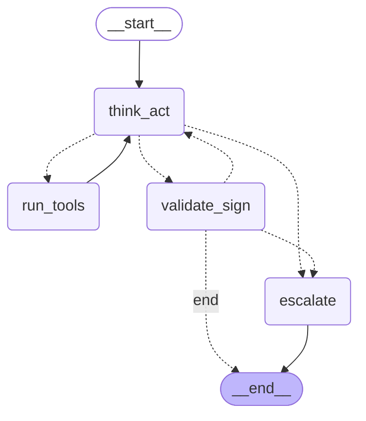

# Architecture diagrams

These are **generated from the compiled graphs**, not drawn. A hand-maintained diagram
starts lying the first time someone adds an edge and forgets to update it.

```bash
python -m scripts.docs.export_graphs            # regenerate
python -m scripts.docs.export_graphs --check    # fail if stale
```

`ai-orchestrator/tests/unit/test_graph_export.py` runs the `--check` mode, so a graph
change that forgets to regenerate these fails the build instead of shipping a wrong
picture.

## Analyst

Read-only. Reads the claim document, resolves the claimant's policy, emits a
`TriageReport` and an HMAC-signed `ClaimProposal`. Never persists anything.



Source of truth: [`analyst-graph.mmd`](analyst-graph.mmd).

## Auditor

Same topology, different prompt and output. Receives the analyst's HMAC-verified triage
plus the deterministic verification as ground truth, re-fetches independently, and emits
a `ClaimDecision`. It is allowed to disagree with the analyst — that is its job.

Source of truth: [`auditor-graph.mmd`](auditor-graph.mmd).

## Reading these

Both graphs share a property worth noticing: **every path terminates.** `think_act` can
loop through `run_tools` and `validate_sign` can loop back for a bounded number of
retries, but the wall-clock deadline and `max_steps` are checked at the top of
`think_act`, and every exhausted path routes to `escalate` → `MANUAL_REVIEW`. There is no
way for a claim to spin forever or to exit without a decision.

The topology is the *static* view. For what happened in one specific claim — timings,
token counts, tool arguments, which checks fired — see
[`observability/`](../../observability/README.md).
